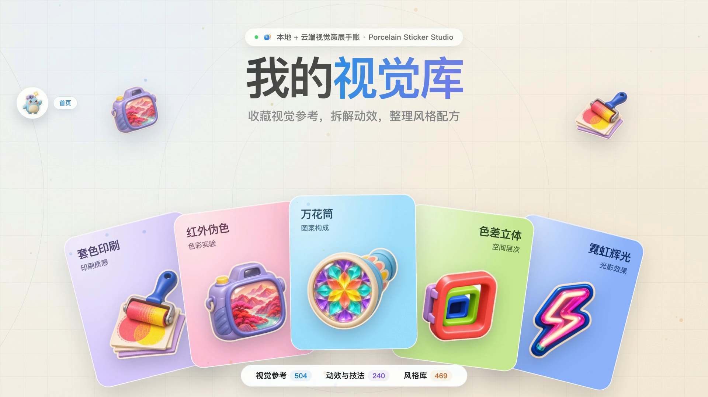
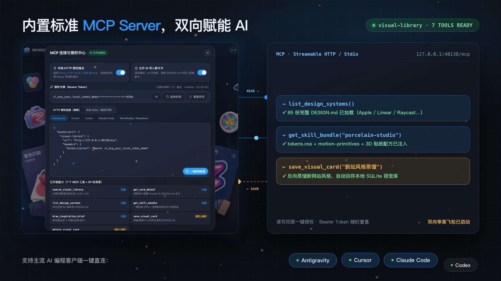

<div align="center">


# My Visual Library · 我的视觉库

**Plug your aesthetic taste directly into your AI coding workflow.**

A local-first visual curation studio, 1,216+ visual references / live motion demos / `DESIGN.md` recipes, and a zero-dependency **MCP Server** for AI coding agents.

[Live Preview](https://zy499.github.io/my-visual-library/) · [简体中文](./README.md) · [English](./README.en.md) · [MCP Guide (ZH)](./MCP接入指南.md) · [Non-Commercial License](./LICENSE)

[](https://zy499.github.io/my-visual-library/)


<br />



</div>

---

## Highlights

- **1,216+ Curated Visual Cards**:
  - **504 Visual References (Atlas)** — risograph, cyanotype, false-color infrared, halftone, anamorphic lens flare, and more.
  - **240 Live Motion Demos (Motion Prompt)** — playable timing, easing, anticipation, and UI micro-interaction references.
  - **469 Style Recipes across 4 Tracks** — Web/UI, Graphic/Poster, Cinema/Photography, and Illustration/3D, including **85+ complete `DESIGN.md` systems** (plus our distilled *Porcelain Sticker Studio* design system).
- **Porcelain Sticker Studio Craft**: Dual-mode warm porcelain (`#f9f7f2`) & midnight titanium (`#090b10`) interface with fanned 5-card hero deck, 6 original 3D die-cut stickers, curved SVG scroll rail with spring-damped mascot, and unified lightbox.
- **Inspiration Blind Box**: Draw 3 complementary cards (Visual Texture + Motion + Design System) for any creative track and synthesize a ready-to-paste AI prompt in one click.
- **Built-in MCP Server (HTTP + Stdio)**: Connect **Antigravity, Cursor, Claude Code, Codex, or DeepSeek** directly to your local SQLite visual library (`search_visual_library`, `get_card_detail`, `list_design_systems`, `draw_inspiration_brief`, `get_skill_bundle`, `save_visual_card`, `delete_visual_card`).
- **2 Reusable Agent Skills**: Bundled under [`skills/`](./skills/) — `porcelain-sticker-studio` and `visual-library-distill`.



---

## Quick Start (30 seconds)

Requires **Node.js 22.13+** (uses built-in `node:sqlite`, zero native build tools needed):

```bash
git clone <your-repo-url> my-visual-library
cd my-visual-library
npm ci
npm run build
npm start
```

Open `http://127.0.0.1:48138/`. On macOS, you can also double-click `启动视觉库.command`.

For cloud deployment on Netlify (Functions + Postgres), check [`netlify.toml`](./netlify.toml) and [`.env.example`](./.env.example).

---

## License — Non-Commercial Only

This project is **strictly non-commercial** (see [`LICENSE`](./LICENSE)):
- **Source code**: [PolyForm Noncommercial License 1.0.0](https://polyformproject.org/licenses/noncommercial/1.0.0)
- **Original visual assets, 3D stickers, design system & skills**: [CC BY-NC-SA 4.0](https://creativecommons.org/licenses/by-nc-sa/4.0/)
- Personal learning, research, and non-commercial sharing with attribution are welcome. **Any commercial use requires prior written permission from the author.**
- Third-party components, CC imagery, and brand design-study disclaimers are documented in [`THIRD-PARTY-NOTICES.md`](./THIRD-PARTY-NOTICES.md).
