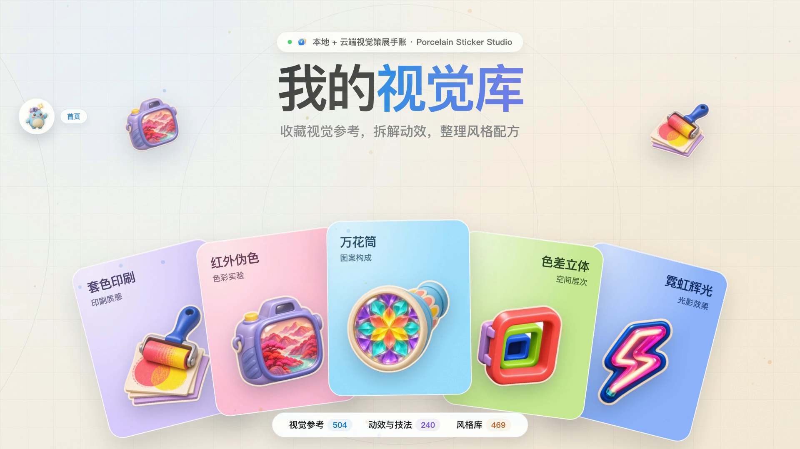
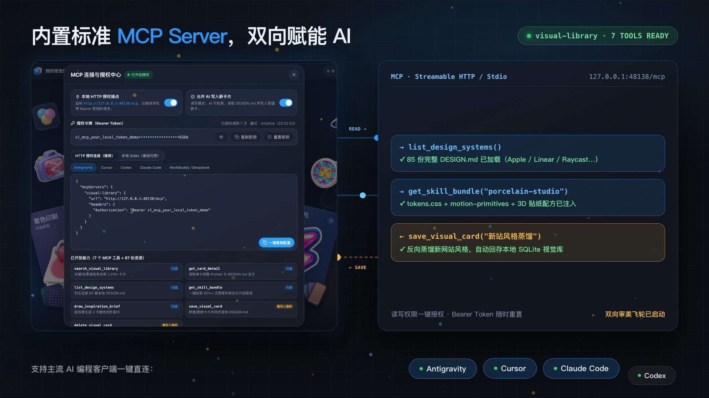

<div align="center">


# 我的视觉库 · My Visual Library

**把你的审美，接入 AI 工作流**

本地优先的视觉策展手账 & AI 设计灵感 MCP 武器库  
收藏视觉参考 · 拆解实时动效 · 整理 `DESIGN.md` 风格配方 · 一键喂给 AI 编程工具

[简体中文](./README.md) · [English](./README.en.md) · [MCP 接入指南](./MCP接入指南.md) · [非商用许可协议](./LICENSE)


<br />

<!-- 提示：上传到 GitHub 后，你可以直接在网页端编辑 README，把本地 promo-video/output/我的视觉库-宣传片-v2-60fps.mp4 拖到这里，会自动渲染为原生视频播放器 -->


</div>

---

## 为什么做「我的视觉库」？

设计师和开发者每天都在收藏好看的网页、海报、动效和配色，但它们往往沉睡在杂乱的文件夹和书签里——轮到让 AI（Cursor / Claude Code / Codex / Antigravity）写新页面时，又只能凭空描述，结果产出千篇一律的「AI 味界面」。

**我的视觉库** 把视觉参考、实时动效和完整 `DESIGN.md` 设计系统结构化存进本地 SQLite（也支持一键部署到 Netlify），并通过内置 **标准 MCP Server** 让你的 AI 编程工具直接检索、调用甚至反向蒸馏新网站风格存回你的视觉库。

---

## 核心特性

### 1. 1,216+ 结构化视觉资产，开箱即用
- **504 张视觉参考图鉴（Atlas）**：套色印刷、蓝晒、红外伪彩、半调网点、电影宽银幕眩光等视觉工艺与构图拆解。
- **240 段可播放动效示范（Motion Prompt）**：现场播放预备动作、弹簧阻尼、界面微交互与运镜示范，直接复制参数与 Prompt。
- **469 套风格配方 × 4 大赛道**：覆盖「网页与产品 UI / 平面与海报排版 / 摄影与电影镜头 / 插画与 3D 画风」，内置 **85+ 份完整 `DESIGN.md` 设计系统**（含本站原创蒸馏的「苹果暖瓷手账风」）。

### 2. 苹果暖瓷手账风 · 明暗双模交互体验
- 融合暖瓷纸面（`#f9f7f2`）与暗夜钛黑（`#090b10`）三态主题切换（明亮 / 跟随系统 / 暗夜）。
- 首页 5 张粉彩扇形精选卡、6 枚原创 3D 模切贴纸、左侧弧形 SVG 滚动导览轨与跟随小吉祥物、全类型统一 Lightbox 预览。
- 本地 SQLite 秒级检索、支持新建/编辑个人卡片、收藏夹以及 `v1 JSON` 导入导出备份。

### 3. 灵感盲盒 · 创意合成台
- 按 `网页 / UI`、`海报 / 封面`、`视频 / 分镜`、`AI 生图 / 3D` 场景随机抽取 **3 张卡片**（视觉质感 + 交互动效 + 风格系统）。
- 支持锁定喜欢的单卡、输入创作主题，**一键合成发给 AI 的融合创作 Prompt**。

### 4. 内置零依赖 MCP Server · 双向审美飞轮



- 支持 **界面授权 Streamable HTTP 模式**（随时开关服务、切换只读/允许写入、一键重置 Bearer Token）与 **本地 Stdio 离线模式**。
- 暴露 7 个标准 MCP 工具：`search_visual_library`、`get_card_detail`、`list_design_systems`、`draw_inspiration_brief`、`get_skill_bundle`、`save_visual_card`、`delete_visual_card`。
- 兼容 **Antigravity / Cursor / Claude Code / Codex / DeepSeek** 等主流客户端，详见 [MCP 接入指南](./MCP接入指南.md)。

### 5. 附带两套可复用 Agent Skill
- [`skills/porcelain-sticker-studio/`](./skills/porcelain-sticker-studio/SKILL.md)：本站「苹果暖瓷手账风」完整设计系统 Skill（含 `tokens.css`、`motion-primitives.jsx`、3D 贴纸生图配方）。
- [`skills/visual-library-distill/`](./skills/visual-library-distill/SKILL.md)：通用网站风格蒸馏工作流 Skill，可将任意喜欢的新网站反向蒸馏为 `DESIGN.md` 并写入你的视觉库。

---

## 30 秒本地启动

要求 **Node.js 22.13 或更新版本**（原生支持内置 `node:sqlite`，零 C++ 编译依赖）：

```bash
git clone <你的仓库地址> my-visual-library
cd my-visual-library
npm ci
npm run build
npm start
```

打开浏览器访问 `http://127.0.0.1:48138/` 即可使用。

- **Mac 一键启动**：构建完成后，直接双击根目录的 [`启动视觉库.command`](./启动视觉库.command) 即可自动启动服务并打开浏览器。
- **开发模式**：运行 `npm run dev`（同样直连本机 SQLite）。
- **测试校验**：运行 `npm test` 验证 SQLite 存储、API 与 MCP Server。

---

## 环境变量与云端部署（Netlify）

项目已内置 [`netlify.toml`](./netlify.toml) 与 [`netlify/functions/`](./netlify/functions/)（支持 Netlify Functions + Postgres 云端同步），参考 [`.env.example`](./.env.example)：

| 变量名 | 适用场景 | 说明 |
|---|---|---|
| `VISUAL_LIBRARY_PORT` | 本地运行 | 自定义本地端口，默认 `48138` |
| `VISUAL_LIBRARY_DATA_DIR` | 本地运行 | 自定义 SQLite 数据库存放目录（Mac 默认在 `~/Library/Application Support/我的视觉库/`） |
| `ADMIN_PASSCODE` | Netlify 云端 | 设置管理员口令，保护公开部署站点的写操作与 MCP 配置 |

---

## 项目结构

```text
├── src/                        # React 19 + Tailwind CSS v4 + Motion 前端应用
├── server/                     # 本地 HTTP 服务、内置 node:sqlite 存储与 MCP Server
├── netlify/                    # Netlify Functions 云端接口与 Postgres 适配
├── skills/                     # 两套可复用 Agent Skill（暖瓷手账风 & 通用风格蒸馏）
├── 图鉴素材/                    # Atlas 图鉴、Motion Prompt 动效、风格配方、85+ DESIGN.md 与 3D 贴纸
├── test/                       # SQLite / API / MCP 自动化测试
├── MCP接入指南.md               # 各 AI 客户端详细接入配置说明
└── THIRD-PARTY-NOTICES.md      # 第三方开源组件与素材版权致谢声明
```

---

## 许可协议（严禁商用）

本项目采用 **非商用开源许可协议**（详见 [`LICENSE`](./LICENSE)）：

- **源代码**：采用 **PolyForm Noncommercial License 1.0.0**；
- **原创视觉资产与设计系统**（Logo、6 枚原创 3D 贴纸、`porcelain-sticker-studio` 设计规范与 Skills）：采用 **CC BY-NC-SA 4.0**；
- **允许**：个人学习、学术研究、非商业个人使用与非商业分享（须保留署名与许可声明）；
- **禁止**：任何形式的商业用途（包括但不限于售卖、付费课程/模板/社群捆绑、商业 SaaS 集成或商业交付）。如需商业授权，请提前联系作者获取书面许可。
- 第三方开源组件与参考素材的原始归属及免责声明见 [`THIRD-PARTY-NOTICES.md`](./THIRD-PARTY-NOTICES.md)。
